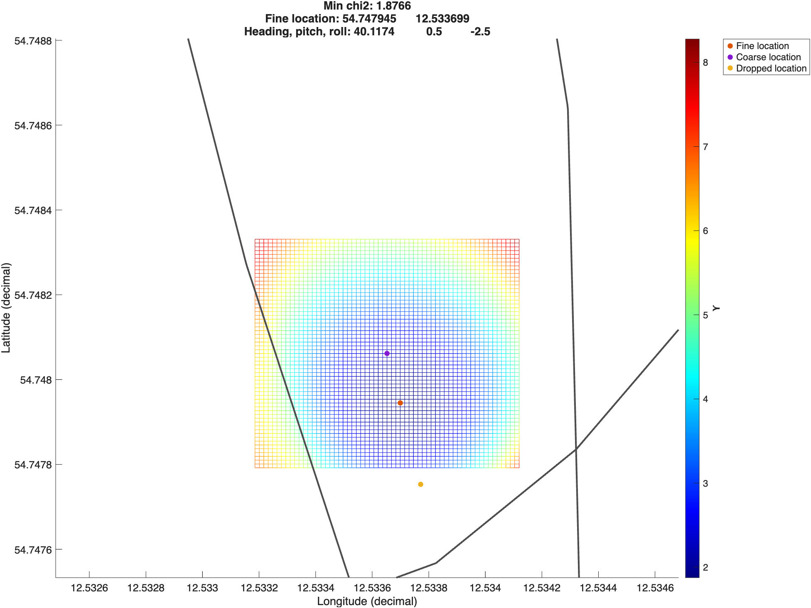
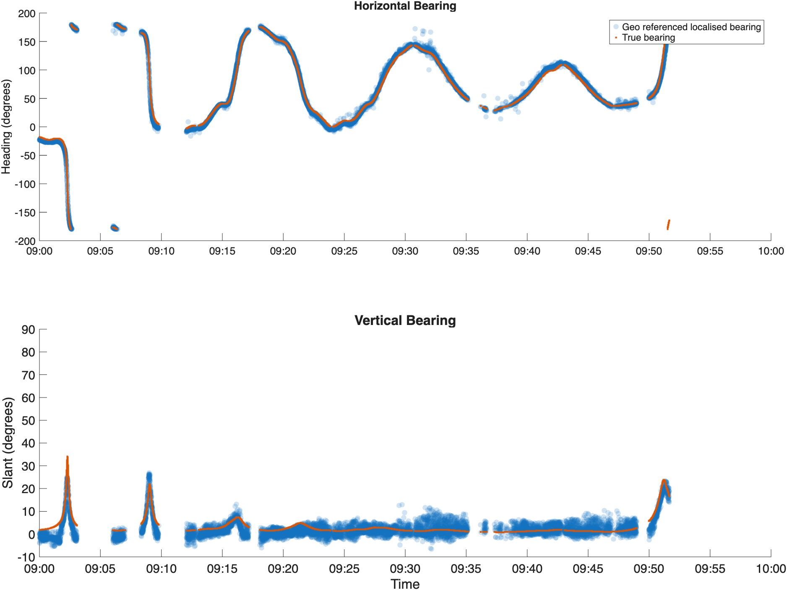
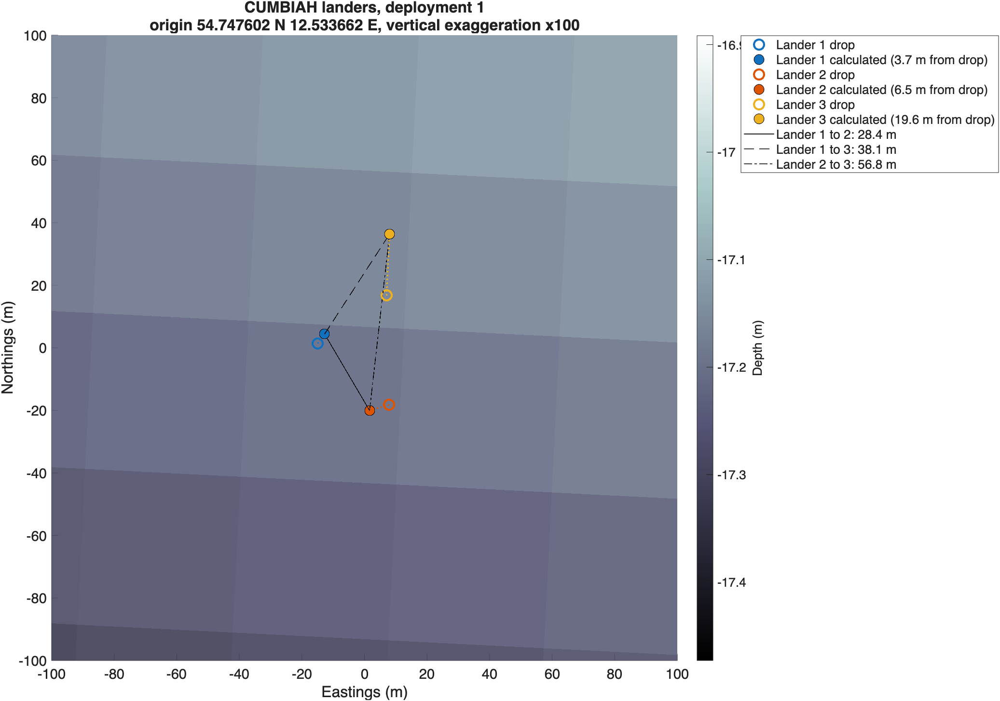

# CUMBIAH Lander MATLAB library
MATLAB library for analysis of CUMBIAH lander data.

## Introduction

The CUMBIAH project deployed landers equipped with small clusters of 4 hydrophones to track the position of porpoises. Each cluster can determine the 3D bearing to a received sound. The research focuses on the echolocation clicks of harbour porpoise: each lander can determine the 3D bearing to a porpoise, and if multiple distributed landers detect the same click then the bearings can be triangulated and the location of the porpoise estimated. This requires several steps. First, the location and orientation of each lander on the seabed needs to be determined. Then clicks from a porpoise need to be matched across landers, and finally a probabilistic tracking algorithm is applied to calculate the track of a porpoise over multiple clicks.

## Usage

The library has two main tasks: locate the landers, and then locate a porpoise across multiple landers.

### Locating the position and orientation of a lander array

A lander rarely ends up exactly where it was dropped, and its heading, pitch and roll on the seabed are unknown. After each deployment the boat performed maneuvers over the landers with it's propeller producing cavitation transients that could be detected on the landers. Each transient gives a bearing at the lander, and the boat GPS tells us where the transient was made, so the lander position and orientation that best explain the bearings can be found with a grid search.

The work is split into:

| File | What it does |
| --- | --- |
| `locateplatform.m` | Function that does the calculation for one lander. Everything is returned in a `results` struct. |
| `locate_platform.m` | Script that locates one lander and plots several diagnostic plots. |
| `locate_array.m` | Script that locates several landers from one deployment and plots them together alongside bathymetry. |

 `locate_platform.m`  and `locate_array.m` scripts  need the library on the MATLAB path. They use `getlanderdeploymentinfo`, `getlanderpaths` and `getlandersuperfolder` to extract the correct PAMGuard database, binary files, drop location etc, to feed into the `locateplatform.m` function (the code that actually does the grid search). The Mapping Toolbox for the bathymetry. 
 
#### How the search works

`locateplatform` runs three passes:

1. **Coarse position search**, repeated over a range of SoundTrap clock offsets (`rtcoffset`). The SoundTrap real time clock drifts against the boat GPS, so the offset giving the lowest chi2 is taken as the true one.
2. **Heading**, as the circular mean of the difference between the click bearings and the true bearings to the boat (assuming the platform lies flat and points north).
3. **Fine search** over position, heading, pitch and roll together, around the coarse answers.

#### Locating a single lander: `locate_platform.m`

Set the country, the lander and the deployment at the top of the script and run it. Lander and deployment numbers are per country; for Denmark the landers are 1-9 and the deployments 1 = Oct 24, 2 = Feb 25, 3 = June 25.

```matlab
country      = 'Denmark';
landernumber = 3;
deployment   = 1;

[startTime, ~, serialnumber] = getlanderdeploymentinfo(landernumber, deployment, country);
data = getlanderpaths(serialnumber, startTime);

results = locateplatform(data, 'depth', 17, 'gridlims', [-40 40], 'gridcenter', data.droplocation);
```

If you ask for a lander that was not in that deployment, `getlanderdeploymentinfo` tells you which ones were.

The script prints the heading (with its circular standard deviation), the fine location and chi2, the heading/pitch/roll, and the distance of the calculated position from the drop and retrieve positions. It then plots:

| Figure | Shows |
| --- | --- |
| 3 | chi2 against SoundTrap clock offset; the lowest is the offset used |
| 4 | Coarse chi2 surface with the calibration click positions (skipped when `setlocation` is used) |
| 5 | Measured vs true click bearings, assuming the lander is flat and pointing north |
| 6 | Bearing difference over time, with the heading as a horizontal line |
| 7 | Fine chi2 surface with the fine, coarse and drop locations |
| 8 | chi2 against heading, pitch and roll |
| 9 | Measured bearings corrected with the fitted heading, pitch and roll, against the true bearings to the boat |

The fine chi2 surface (figure 7) for lander 3, deployment 1. The fine location lies in the minimum of the surface, about 20 m north of where the lander was dropped:



The corrected bearings (figure 9). The blue points are the geo-referenced click bearings measured by the lander and the orange line is the true bearing from the calculated lander position to the boat. If the location and orientation are right, the two overlay closely in both horizontal and vertical bearing:



##### `locateplatform` options

Pass these as name-value pairs:

| Option | Default | Description |
| --- | --- | --- |
| `depth` | `17` | Depth of the platform (m) |
| `binaryday` | deployment day | Day folder of the calibration clicks inside the binary store |
| `database` | `data.sqlitedb` | Database with the calibration events. Falls back to `data.rawsqlitedb`, with a warning, if the annotated database has none |
| `eventtype` | `'bc'` | PAMGuard event type holding the calibration clicks |
| `searchtype` | `'slant'` | `'bearing'`, `'slant'` or `'all'` |
| `rtcoffset` | `-10:0.5:10` | Clock offsets to try (s) |
| `gridsize` | `100` | Points along each side of the coarse grid |
| `gridlims` | `[]` | Coarse grid limits in m around `gridcenter`, `[min max]` or `[northmin northmax eastmin eastmax]`. Empty means limits come from the boat track |
| `gridcenter` | `[]` | `[lat lon]` that `gridlims` is measured from. Required with `gridlims` |
| `maxchi2` | `2e6` | chi2 ceiling for the coarse search |
| `maxbearings` | `5` | Bearings kept per second |
| `finegridspacing` | `1` | Fine grid spacing (m) |
| `finegridlims` | `[-30 30]` | Fine grid limits around the coarse location (m) |
| `fineanglelims` | `[-10 10]` | Heading/pitch/roll search limits (degrees) |
| `fineanglestep` | `0.5` | Heading/pitch/roll step (degrees) |
| `setlocation` | `[]` | `[lat lon]` to force as the coarse location, skipping the coarse search. The clock offset and orientation are still fitted |

A few useful calls:

```matlab
% search the whole boat track (slow)
results = locateplatform(data, 'depth', 17);

% search +/-40 m around the drop position
results = locateplatform(data, 'depth', 17, 'gridlims', [-40 40], 'gridcenter', data.droplocation);

% the lander position is known - fit only the clock offset and orientation
results = locateplatform(data, 'depth', 17, 'setlocation', [54.7478397, 12.5337717]);
```

The main fields of `results` are `locationfine` (`[lat lon]`), `hprfinal` (`[heading pitch roll]` in degrees), `rtctimeoffset` (s) and `chi2fine`. See `help locateplatform` for the full list.

#### Locating the lander array: `locate_array.m`

`locate_array.m` runs `locateplatform` for each lander in a deployment and plots the drop and calculated positions over the seabed, using the Danish KattegatSouth 50 m depth model. Set the options at the top of the script:

```matlab
deployment = 1;          % 1 = Oct 24, 2 = Feb 25, 3 = June 25
landers    = [1 2 3];

depth      = 17;         % lander depth (m), passed to locateplatform
boxsize    = 1000;       % size of the bathymetry square kept around the landers (m)
zexag      = 100;        % vertical exaggeration of the seabed
plotradius = 300;        % plot +/- this many m around the landers
plotgps    = false;      % draw the boat GPS track

recalculate    = true;   % force the localisation to run again
reextractbathy = false;  % force the bathymetry to be cut from the grid again
```

The localisation is slow, so the positions and orientations are saved, one row per lander, as `locstable` in `lander_array_locations_dep<N>.mat` in the lander super folder. They are reloaded on the next run unless `recalculate` is true, or the landers or depth have changed. The full `locateplatform` results (including the chi2 surfaces, which can be GBs) stay in the workspace as `results` and are not saved.

The bathymetry around the landers is cut from the full grid once and saved as `bathymetry/lander_array_bathymetry_dep<N>.mat`. It can be reloaded without the grid:

```matlab
load(bathyfile, 'bathy')
```

`bathy.depth` is in metres (negative down) on cell centres, given as UTM 32N (`bathy.easting`, `bathy.northing`) and as `bathy.lat`, `bathy.lon`. `bathy.R` is the map raster reference.

The script prints the drop and calculated position and the heading/pitch/roll of each lander. It then plots them in metres east and north of the mean drop position. Open circles are the drop positions, filled circles the calculated positions, and the legend gives each lander's distance from its drop position and the distance between each pair of landers:



### Locating a porpoise

#### Bearing tracks on a single lander: `cumbiah_multitrack.m`

`track_porpoises/cumbiah_multitrack.m` cuts the porpoise clicks of one lander deployment into encounters, groups the clicks of each encounter into bearing tracks (one per animal) and writes the tracks as `pp` events to a PAMGuard database, where they can be checked and edited in the viewer. The tracking code itself is in `soundnetloc_mat/click_train_tracking` (`find_encounters`, `track_bearings`, `write_track_events`, `plot_bearing_tracks`).

Set the lander and the database at the top of the script:

```matlab
country      = 'Denmark';
landernumber = 1;
deployment   = 1;

trackdb   = data.porpoisedB;   % the lander's ..._porpoise.sqlite3 database; must exist
writedb   = true;    % write the tracks to trackdb
overwrite = false;   % false = stop if trackdb already has tracks of this deployment
```

The tracks go to the lander's `*_porpoise.sqlite3` database, `data.porpoisedB` in the record from `getlanderpaths`. It has to exist already (a copy of the annotated database is the usual choice). Track codes are stored in the event comment, e.g. `PP1003AB01` is deployment 1, encounter 3, track AB. The bearings are left relative to the lander; its orientation is applied later, when the tracks are located. A `.mat` of the encounters and a figure of each encounter are saved in `<lander folder>/multitrack`.

#### Matching, time aligning and localising across the array: `localise_porpoises.m`

`localise_porpoises/localise_porpoises.m` brings the two steps above together. Run it after `locate_array.m` and after `cumbiah_multitrack.m` has been run for every lander of the array. The work is split as for locating the landers:

| File | What it does |
| --- | --- |
| `localiseporpoises.m` | Function that matches the tracks, time aligns the landers and localises the animals. |
| `localise_porpoises.m` | Script that builds the inputs for one array and calls it. |
| `plot_loctrack_landers.m` | Plots localised tracks, coloured by time, over the bathymetry with the landers. |

The inputs are a cell array of two or more (usually three) deployment records, one per lander, and the `.mat` file saved by `locate_array.m`:

```matlab
for i = 1:3
    [t0, ~, sn] = getlanderdeploymentinfo(i, 1, 'Denmark');
    data{i} = getlanderpaths(sn, t0);
end
arrayfile = fullfile(getlandersuperfolder('Denmark'), 'lander_array_locations_dep1.mat');

[loctracks, info] = localiseporpoises(data, arrayfile);                   % everything
[loctracks, info] = localiseporpoises(data, arrayfile, 'encounters', 3:5); % three encounters
[~, info] = localiseporpoises(data, arrayfile, 'localise', false);        % clocks and matching only (quick)
```

What it does:

1. **Tracks.** The tracks of the deployment are read back from each lander's `data.porpoisedB`, so analyst edits in the PAMGuard viewer are used. Tracks during the boat calibration (`bc` events) are left out.
2. **Encounters.** Runs of tracks on any lander with no gap of more than 5 minutes; those with tracks on two or more landers are kept and coded `PA1001`, `PA1002`, ... (deployment 1). The `PP` codes of `cumbiah_multitrack.m` are per lander and are not used for matching.
3. **Clocks.** A comb filter between the click times of each pair of landers gives the clock offset of every lander from the first one. It is done twice: a wide search following the offset from encounter to encounter, a line fitted to those offsets (the clocks drift apart steadily), then a narrow search around the line. The `rtctimeoffset` of `locateplatform` is not used.
4. **Matching.** Each pair of landers is associated with `associate_tracks` (bearings must cross, click times must line up); tracks joined through any pair are one animal, e.g. `PA1003AB`.
5. **Localisation.** The hydrophones of each lander are rotated by its heading, pitch and roll and put at its position, and each association is run through the particle filter (`trackstartloc_bounded`, `partice_filter_pam`). A track fragment needs clicks on at least two landers.

Results go to `<lander super folder>/localisation`: `landers123_dep1_loctracks.mat` (the tracks, with the clock offsets and associations of every encounter), a figure of the tracks of each encounter over the bathymetry coloured by time, a figure of the matched bearing tracks of each encounter, and `landers123_dep1_clock.png`, the clock offsets through the deployment. See `help localiseporpoises` for the options and the fields of `loctracks`.

As well as the CUMBIAH library, soundnet and PAMGUARD this needs the CIBBRiNA `soundtrap_4c/localisation` code and the particle filter (`MATLAB/localisation`) on the path.

The tracks are read with `load_event_clicks` (soundnet), without the waveforms. If a lander's record has `data.clicksfile` set, the tracks are read from that `.mat` file instead of the database and binary store. It holds `click_events`, as `load_event_clicks` returns them, and `hydrophones`, the array as PAMGuard has it.

#### Testing with simulated tracks: `test_localise_simulated.m`

`localise_porpoises/_test/test_localise_simulated.m` checks the whole chain against known answers. It puts three landers on a ~30 m triangle, each with its own heading, pitch, roll and clock offset, swims four animals around them in three encounters (two at the same time), and makes the clicks each lander would record: arrival time on the lander's clock, time delays with SNR-based errors, and bearings in the frame of the hydrophones, as PAMGuard has them. The clicks are saved as one `clicksfile` per lander and run through `localiseporpoises`. The test then checks the lander positions, the clock offsets, that every association is one animal, and the error of the localised tracks against the true ones, and saves a figure of both.

## License
This library is open source but it is constantly evolving. It is for the research use of the CUMBIAH project but can be copied, adapted and used as per the open source license. We will not provide support outside of CUMBIAH.
